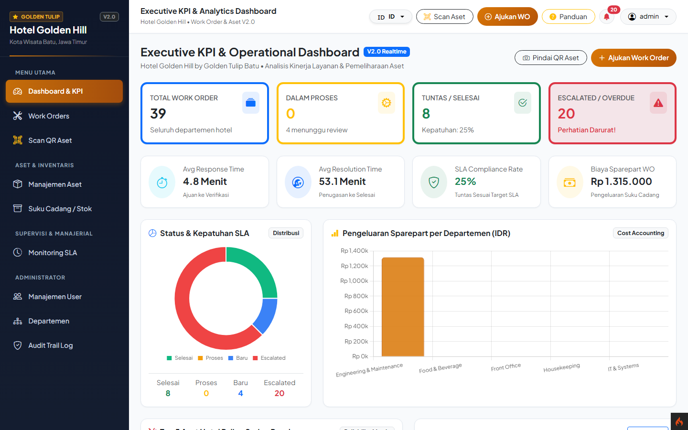
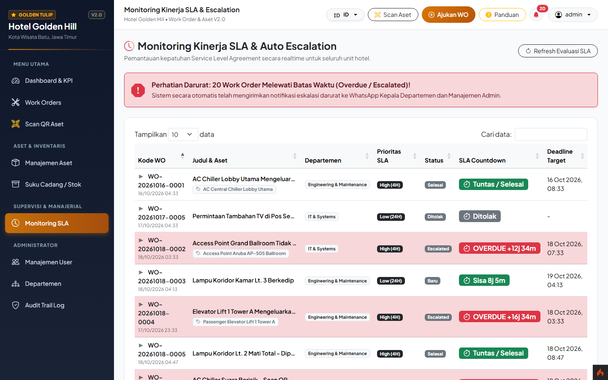
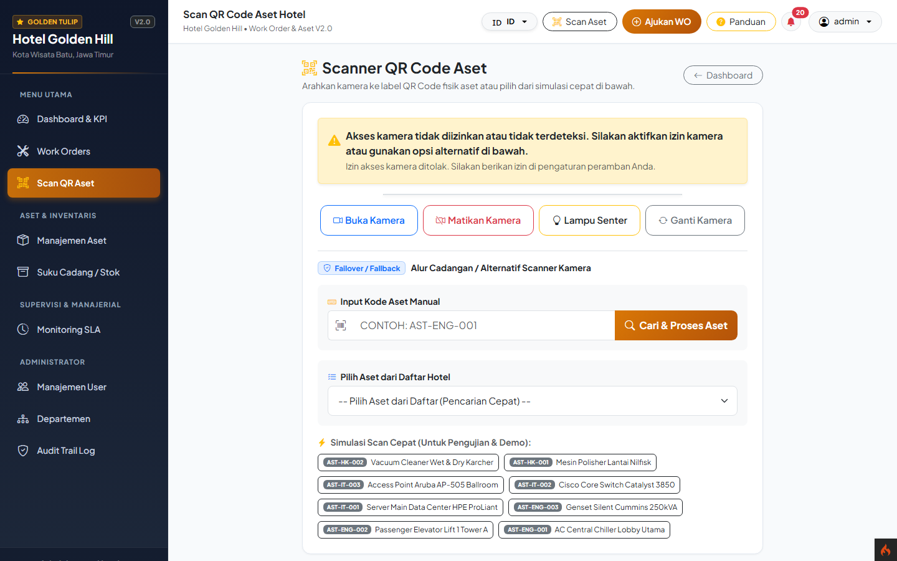
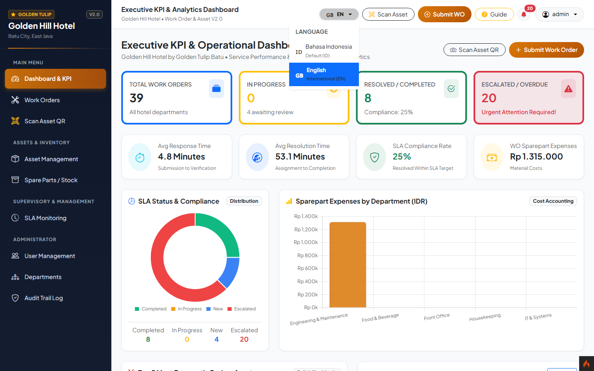

[ Read in English 🇬🇧 ](README.en.md) | [ Bahasa Indonesia 🇮🇩 ](README.md)
<hr>

# SISTEM INFORMASI WORK ORDER, MANAJEMEN ASET, DAN ANALYTIC PERFORMANCE V2.0
### Hotel Golden Hill by Golden Tulip Batu
**Berdasarkan Tugas Akhir:** Hizkia Tegar Kurniawan (NIM: 223140707111136, Universitas Brawijaya)  
**Tingkat Pengembangan:** Enterprise Industrial Grade (V2.0)

---

## 📸 Visual Showcase

<div align="center">

### Executive KPI & Performance Analytics Dashboard


<br>

### Work Order Monitoring & SLA Countdown Timer


<br>

</div>

| 🔍 Asset QR Code Scanner | 🌐 Multi-Language (ID / EN) |
| :---: | :---: |
|  |  |

---

## 1. Arsitektur & Teknologi Sistem
- **Backend Framework:** PHP 8.2+ dengan CodeIgniter 4 (MVC Architecture)
- **Basis Data:** MySQL / MariaDB (Database: `ci4_workorder_v2`)
- **Frontend UI/UX:** Bootstrap 5, HTML5, Custom CSS3, Vanilla JS, DataTables.net, Chart.js 4.4
- **Pustaka Pendukung Enterprise:**
  - **Excel Engine:** `phpoffice/phpspreadsheet`
  - **PDF Generator:** `dompdf/dompdf`
  - **QR Code Engine:** `endroid/qr-code` (Backend PNG Generator) & `html5-qrcode` (Live Camera Scanner)
  - **WhatsApp API Gateway:** Fonnte / Wablas integration module with local simulation sandbox fallback
- **Server Environment:** XAMPP / Apache Local Architecture (`http://localhost/work-order/`)

---

## 2. Struktur Database Relasional (12 Tabel)
Database `ci4_workorder_v2` dirancang dengan relasi InnoDB, Primary Key, Foreign Key Constraints, dan Indexing:
1. `roles`: Master peran pengguna (`Admin`, `Kepala Departemen`, `Staf`).
2. `departemen`: Master unit operasional (`Engineering & Maintenance`, `IT & Systems`, `Housekeeping`, `Front Office`, `Food & Beverage`).
3. `users`: Entitas pengguna dengan hash password BCRYPT, nomor WhatsApp, relasi departemen, dan peran.
4. `kategori_wo`: Klasifikasi tiket (`Maintenance`, `IT Support`, `Housekeeping Service`, `General Repair`).
5. `status_wo`: Alur siklus tiket (`Baru`, `Accepted`, `Ditolak`, `Ditugaskan`, `Proses`, `Selesai`, `Menunggu Konfirmasi`, `Escalated`).
6. `prioritas_sla`: Target penyelesaian (`Low` 24 Jam, `Medium` 12 Jam, `High` 4 Jam, `Emergency` 1 Jam).
7. `aset_hotel`: Master fasilitas hotel, kode aset unik, departemen, lokasi fisik, path gambar QR code, dan status kondisi fisik (`Baik`, `Rusak Ringan`, `Rusak Berat`).
8. `inventaris_barang`: Stok suku cadang hotel, satuan, dan harga satuan material.
9. `work_order`: Master transaksi tiket perbaikan, relasi pelapor, departemen penanggung jawab, teknisi handler, approval kadep, durasi nyata pengerjaan, dan kalkulasi biaya.
10. `wo_spareparts`: Relasi many-to-many pemakaian suku cadang per work order beserta subtotal biaya.
11. `log_audit`: Rekam jejak seluruh transaksi CRUD, autentikasi login/logout, eskalasi otomatis, dan IP address.
12. `reset_password_token`: Token terenkripsi self-service pemulihan kata sandi.
13. `notification_queue`: Antrean notifikasi asinkron WhatsApp & Email dengan mekanisme retry dan automatic SMTP failover.

---

## 3. Akun Pengguna Default (Multi-Role)
| No | Role | Username | Password | Nama Lengkap | Departemen |
|:---|:---|:---|:---|:---|:---|
| 1 | **Admin** | `admin` | `admin123` | Administrator Hotel | IT & Systems |
| 2 | **Admin** | `hizkia` | `hizkia123` | Hizkia Tegar Kurniawan | IT & Systems |
| 3 | **Kepala Departemen** | `kadep_eng` | `kadep123` | Ir. Budi Santoso | Engineering & Maintenance |
| 4 | **Staf** | `staf_eng` | `staf123` | Joko Prasetyo | Engineering & Maintenance |
| 5 | **Kepala Departemen** | `kadep_it` | `kadep123` | Rian Pratama, S.Kom | IT & Systems |
| 6 | **Staf** | `staf_it` | `staf123` | Fajar Ramadhan | IT & Systems |
| 7 | **Kepala Departemen** | `kadep_hk` | `kadep123` | Siti Aminah | Housekeeping |
| 8 | **Staf** | `staf_hk` | `staf123` | Dewi Lestari | Housekeeping |
| 9 | **Staf** | `staf_fo` | `staf123` | Reza Firmansyah | Front Office |

*Fitur Quick Role Switcher*: Penguji dapat beralih antar role akun secara instan melalui tombol **Switch Role (Demo)** pada sidebar bawah untuk memvalidasi alur tanpa perlu bolak-balik logout.

---

## 4. Modul Unggulan & Fitur Enterprise
1. **Auto Escalation & Live SLA Countdown Timer:**
   - Menghitung sisa waktu penyelesaian otomatis berdasarkan prioritas SLA.
   - Indikator visual real-time (Badge Hijau: Aman, Kuning: <30% tersisa, Merah/Blinking: Overdue).
   - Mesin eskalasi otomatis mengubah status tiket menjadi `Escalated` saat melewati batas target deadline dan memicu peringatan darurat ke manajemen.
2. **Integrasi WhatsApp Gateway & Email Failover:**
   - Antrean asinkron (`notification_queue`) tanpa memblokir request pengguna via `NotificationService`.
   - Pengalihan otomatis (*Automatic Failover*) ke Email HTML (SMTP) apabila gateway WhatsApp mengalami galat/timeout.
3. **QR Code Scanner Aset Hotel & Mitigasi Kamera:**
   - Pemindai kamera HTML5 langsung dari browser ponsel/PC.
   - Dilengkapi kontrol senter (*flashlight/torch*), ganti kamera, dan alur cadangan input kode aset manual / searchable dropdown saat izin kamera ditolak.
4. **Pemotongan Inventaris & Biaya Maintenance (Pessimistic Locking):**
   - Transaksi atomik dengan penguncian baris eksplisit (`SELECT ... FOR UPDATE`) pada tabel `inventaris_barang` untuk mencegah race condition.
   - Pembatalan transaksi (*rollback*) otomatis dengan pesan peringatan ramah jika stok tidak mencukupi.
5. **Sistem Internasionalisasi Penuh (i18n Dwi-Bahasa ID/EN):**
   - Pengalih bahasa dinamis di navbar (`/lang/id` dan `/lang/en`) dengan persistensi ke Session, Cookie, dan Database pengguna.
   - Seluruh antarmuka, pesan validasi, tabel DataTables, dan dokumen ekspor Excel/PDF beradaptasi otomatis.
6. **Mitigasi Blindspot Sinyal (PWA & Offline Draft Auto-Sync):**
   - Service Worker (`sw.js`) dan Manifest PWA untuk pengoperasian dasar di ruang bawah tanah/ruang mesin.
   - Penyimpanan draf tiket ke `localStorage` saat offline dan sinkronisasi otomatis (*background sync*) saat jaringan kembali pulih.
7. **Executive Analytics & KPI Dashboard:**
   - Grafik interaktif Chart.js:
     - *Average Response Time* (Ajuan ke Verifikasi)
     - *Average Resolution Time* (Penugasan ke Selesai)
     - *SLA Compliance Rate* (% Tuntas Tepat Waktu vs Overdue)
     - *Distribusi Biaya Sparepart per Departemen*
     - *Top 5 Aset Hotel Paling Sering Rusak*
8. **Keamanan, Reset Password & Audit Trail:**
   - Token pemulihan kata sandi 32-byte berbatas waktu 1 jam.
   - Pencatatan kronologis aktivitas pada `log_audit` lengkap dengan nama pengguna, peranan, timestamp, dan alamat IP.

---

## 5. Panduan Instalasi & Pengaturan Lokal

### Prasyarat Sistem
- PHP 8.2 atau lebih baru (dengan ekstensi `intl`, `mbstring`, `mysqli`, `gd`, `curl`)
- MySQL / MariaDB (Server lokal XAMPP)
- Composer 2.x
- Web Server Apache (XAMPP di `C:\xampp\htdocs\work-order`)

### Langkah Pemasangan
1. **Clone Repositori:**
   ```bash
   git clone https://github.com/HizkiaTegar26/work-order-hotel-golden-hill.git
   cd work-order-hotel-golden-hill
   ```
2. **Pasang Dependensi PHP:**
   ```bash
   composer install
   ```
3. **Konfigurasi Lingkungan (`.env`):**
   Salin berkas `env` menjadi `.env` dan sesuaikan pengaturan database:
   ```ini
   CI_ENVIRONMENT = development
   app.baseURL = 'http://localhost/work-order/'
   database.default.hostname = localhost
   database.default.database = ci4_workorder_v2
   database.default.username = root
   database.default.password = 
   database.default.DBDriver = MySQLi
   ```
4. **Migrasi Skema & Seeding Data:**
   ```bash
   php spark migrate
   php spark db:seed DatabaseSeeder
   ```
5. **Jalankan Aplikasi:**
   Akses melalui peramban web pada [http://localhost/work-order/](http://localhost/work-order/).

---

## 6. Validasi & Pengujian Otomatis

### 6.1 Black Box Validation Suite (25 Test Cases)
```bash
php spark test:blackbox
```
Hasil pengujian: **25 VALID (PASS) / 0 GAGAL (100% KELULUSAN)**.

### 6.2 Robustness & Failover Suite (15 Test Cases)
```bash
php spark test:robustness
```
Hasil pengujian: **15 VALID (PASS) / 0 GAGAL (100% KELULUSAN)**.

---

## 7. Perintah CLI Pendukung
- `php spark wo:escalate` : Menjalankan evaluasi berkala auto-escalation tiket overdue.
- `php spark queue:work --once` : Memproses antrean notifikasi WhatsApp & Email failover.
- `php spark test:blackbox` : Menjalankan pengujian 25 skenario Black Box multi-role.
- `php spark test:robustness` : Menjalankan verifikasi 15 pengujian ketahanan & failover.
- `php spark db:seed DatabaseSeeder` : Mengisi ulang data awal pengujian realistis.

---

## 8. Pengembang & Lisensi
- **Pengembang:** Hizkia Tegar Kurniawan (NIM: 223140707111136)
- **Institusi:** Program Studi D4 Manajemen Informatika, Fakultas Vokasi, Universitas Brawijaya
- **Mitra Industri:** Hotel Golden Hill by Golden Tulip Batu
- **Lisensi:** MIT License - Bebas digunakan dan dikembangkan untuk keperluan akademik dan operasional perhotelan.
